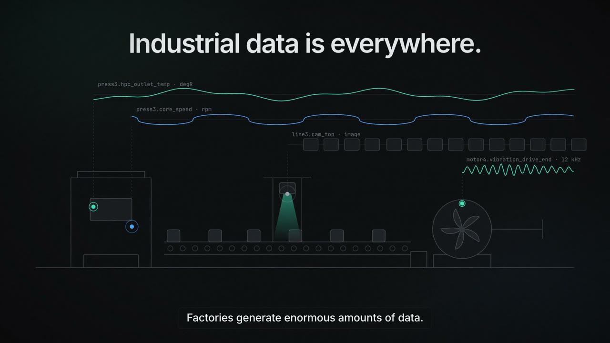
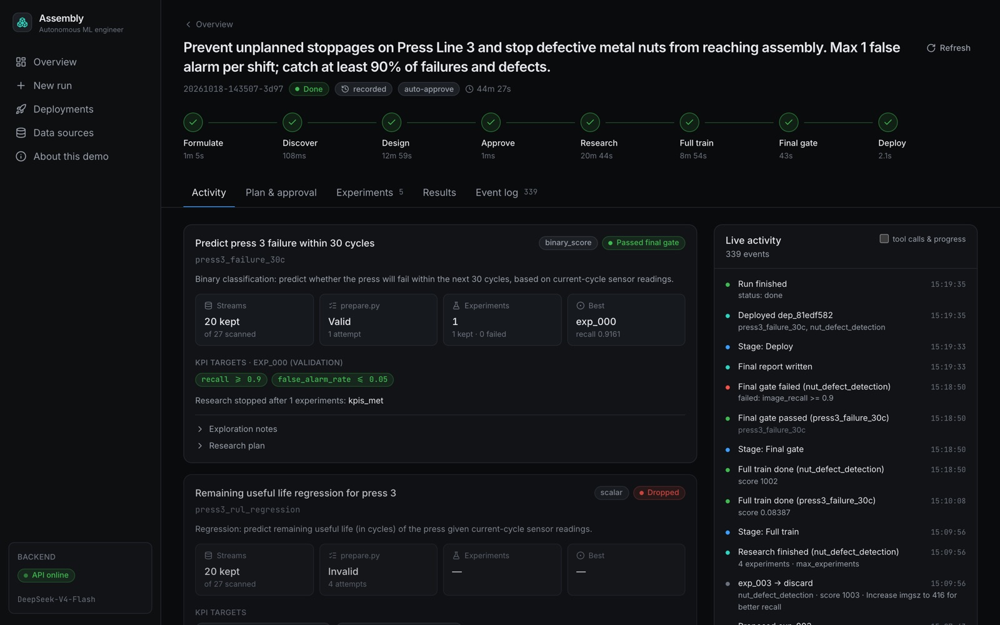
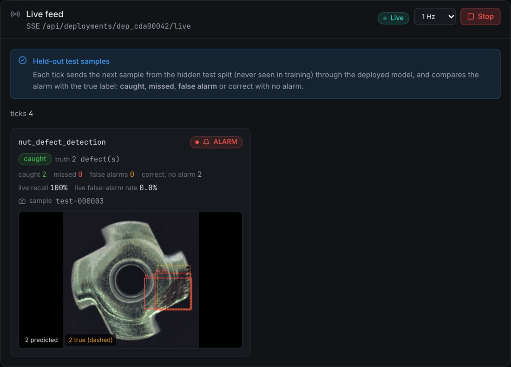

# Assembly

**An autonomous ML engineer for factories.** Give Assembly a goal in plain language and it finds the right plant
data, builds the dataset, researches and tests models, and deploys the ones that meet your targets, without any
code or ML expertise from you.

**[Live demo](https://assembly-tokenfactory.vercel.app/)** · **[Demo video](https://assembly-tokenfactory.vercel.app/Assembly-Demo.mp4)** · [Hosting guide](docs/hosting.md) · [Design notes](PLAN.md)

[](https://assembly-tokenfactory.vercel.app/Assembly-Demo.mp4)

> The live demo runs on free infrastructure: the backend sleeps when idle, so the first load can take a few
> seconds, and a new run takes 30 to 45 minutes. Recorded runs and their deployed models are ready to explore.

---

## What it does

Plants already collect sensor histories, vibration recordings, camera images, maintenance logs and QC inspections.
Turning that into a working model normally takes an ML team weeks. With Assembly, an operator writes something like:

> *Prevent unplanned stoppages on Press Line 3 and stop defective metal nuts from reaching assembly.
> Max 1 false alarm per shift; catch at least 90% of failures and defects.*

The agent then:

1. **Formulates** concrete ML tasks with measurable KPIs (e.g. "will this press fail within 30 cycles?", "where
   is the defect on this part?").
2. **Discovers** which plant streams matter for each task.
3. **Designs** each dataset by writing its own `prepare.py`; validators check it for leakage and sanity before
   an operator approves it.
4. **Researches** models in an [autoresearch](https://github.com/karpathy/autoresearch)-style loop: it explores
   the data, plans experiments, writes `train.py`, runs it under a time budget, and keeps a change only if fixed
   scoring code, comparing against labels the agent never sees, says it's better.
5. **Ships** the winner: full training, a final gate on a hidden test split, packaging and a live endpoint.

The LLM is creative; everything that decides success is deterministic code it can't change.

## How it works

```
 Goal + KPIs ─► Formulate ─► Discover ─► Design: prepare.py → validate → approve → freeze
                                                                │
           ┌────────────────────────────────────────────────────┘
           ▼
   Explore data + plan ─► propose train.py ─► pre-run checks ─► run (time budget) ─► score vs hidden labels
           ▲                                                                               │
           └────────────── keep if better, else discard (crashes go to a fix loop) ◄───────┘
                                                                │  until KPIs met / budget spent
                                                                ▼
                    Full train ─► final gate on hidden test split ─► package ─► deploy ─► live feed
```

What keeps an LLM-written ML pipeline honest:

- **Hidden labels.** Validation and test labels live outside the agent's workspace; the code it writes never sees
  them, and scoring happens in fixed code.
- **Dataset validators.** Group / time leakage, split sizes, label sanity and label-copy checks run before any
  training; the data card the agent reads afterwards is generated, not written by the LLM.
- **Pre-run checks.** Every `train.py` and `prepare.py` is compiled and its library calls are checked against the
  *installed* package signatures before it runs; problems go back to the agent as targeted repairs.
- **Exploration, planning and a fix loop.** The agent inspects the real data with sandboxed snippets, keeps a
  research plan it revises from results, and sees its own earlier fix attempts when something crashes.
- **Sandboxed execution.** Agent code runs in subprocesses or [Daytona](https://www.daytona.io) sandboxes with
  outbound network blocked, behind a pluggable executor interface.

## Results

Recorded end-to-end runs with a real LLM (DeepSeek-V4-Flash on AMD Token Factory), all code written by the agent.
Metrics are on the **hidden test split** the agent never saw:

| Task (framed by the agent) | Data | KPIs | Result |
|---|---|---|---|
| Will the press fail within 30 cycles? | C-MAPSS sensors + maintenance log | recall ≥ 0.9, false-alarm rate ≤ 0.05 | **Passed**: recall 0.982, false-alarm rate 0.047, AUROC 0.996 |
| Same task, second run (trained in a Daytona sandbox) | C-MAPSS sensors + maintenance log | recall ≥ 0.9, false-alarm rate ≤ 0.05 | **Passed**: recall 0.963, false-alarm rate 0.032, AUROC 0.994 |
| Where is the defect on this part? (boxes) | Camera images + QC inspections | image recall ≥ 0.9, image false-alarm rate ≤ 0.1 | **Passed**: image recall 1.0, false-alarm rate 0.02, mAP50 0.68 |
| How many cycles until failure? | C-MAPSS sensors + maintenance log | early-warning recall ≥ 0.9, false alarms ≤ 0.05 | Missed: early-warning recall 0.876 |

Not every task passes, and the system says so: failed gates are reported in plain language and shown in the UI.
Each run takes 30 to 60 minutes and costs a few cents of LLM usage.

| Run workspace (recorded run) | Live feed on held-out test images |
|---|---|
|  |  |

## Data sources in the demo plant

| Dataset | Presented as | Possible tasks |
|---|---|---|
| [NASA C-MAPSS turbofan degradation](https://data.nasa.gov/dataset/cmapss-jet-engine-simulated-data) | Press 3 sensor streams + maintenance log | failure prediction, remaining useful life |
| [CWRU Bearing Data Center](https://engineering.case.edu/bearingdatacenter) | Motor 4 vibration recordings + bearing inspections | fault classification |
| [MVTec AD: metal nut](https://www.mvtec.com/company/research/datasets/mvtec-ad) | Line 3 top camera + QC inspections | defect detection (anomaly scores or boxes) |

Three generated distractor streams (hall temperature, shift counter, noise) sit alongside them.

### Adding your own data

Data sources are declared by *kind* in [`src/plant/catalog.yaml`](src/plant/catalog.yaml), so a new source is one
entry, not new code:

```yaml
sources:
  line2_historian:
    kind: table              # table | signal | image_folder | video
    path: line2/historian_export.parquet
    format: parquet          # csv (default) | parquet | whitespace
    entity: machine_id       # which column identifies the machine
    time: timestamp          # which column orders its readings

streams:
  - id: line2.spindle_temp   # what the agent sees: one entry per signal it may use
    name: Line 2 spindle temperature
    modality: temperature
    unit: degC
    source: line2_historian:spindle_temp_c   # <source>:<column>
```

Tables (historian or SCADA exports), high-frequency recordings, image folders and video are supported, and the
logs a plant already keeps (maintenance events, QC inspections) become label sources. Assembly can be self-hosted,
so no data has to leave the factory.

## Architecture

```
 Browser ──► Vercel (React app) ──REST + SSE──► Modal: FastAPI + LangGraph agent (one container, scales to zero)
                                                   ├── AMD Token Factory: LLM calls (OpenAI-compatible)
                                                   ├── Daytona: sandboxes that run the agent's train.py
                                                   └── Modal volume: data/ and runs/ (recorded runs, packages)
```

| Layer | Stack |
|---|---|
| Frontend | Vite, React 19, TypeScript, Tailwind CSS, Recharts; deployed on Vercel |
| API | FastAPI with Server-Sent Events for the agent's activity and live predictions; deployed on Modal |
| Agent | LangGraph: outer pipeline graph plus design and research subgraphs; LLM via AMD Token Factory |
| ML | pandas, scikit-learn, XGBoost, LightGBM, PyTorch (ResNet-18 PatchCore-style anomaly model), Ultralytics YOLO11, ONNX |
| Execution | Local subprocesses or Daytona CPU sandboxes (`EXECUTOR=local\|daytona`), behind a provider interface |

## Getting started

**Requirements:** Python 3.12 with [uv](https://docs.astral.sh/uv/), Node.js 20+, and an OpenAI-compatible LLM
endpoint (we use AMD Token Factory; see [docs/Token-Factory.md](docs/Token-Factory.md)).

```bash
uv sync --group ml                                   # Python deps incl. the ML stack
cp .env.example .env                                 # set LLM_API_KEY (and DAYTONA_API_KEY for EXECUTOR=daytona)

uv run python scripts/download_data.py --only cmapss # sensor data (also: cwru, weights, yolo)
uv run python scripts/download_data.py --only mvtec --mvtec-tar <metal_nut.tar.xz>   # MVTec needs its licence

uv run uvicorn api.main:app --port 8000              # API: http://localhost:8000/docs
cd frontend && npm install && npm run dev            # UI:  http://localhost:5173
```

Without an LLM or datasets, `ML_MOCK=1 LLM_MOCK=1` runs the whole flow with fake results, for UI and pipeline work.
Headless runs: `uv run python scripts/run_pipeline.py --goal "..."`. Tests: `uv run pytest`.

### Configuration

| Variable | Purpose | Default |
|---|---|---|
| `LLM_BASE_URL` / `LLM_MODEL` / `LLM_API_KEY` | OpenAI-compatible LLM endpoint | AMD Token Factory, `DeepSeek-V4-Flash` |
| `ML_MOCK` / `LLM_MOCK` | `1` = fake ML results / canned LLM replies | `0` |
| `EXECUTOR` | Where `train.py` runs: `local` or `daytona` | `local` |
| `DAYTONA_API_KEY` | Needed for `EXECUTOR=daytona` | |
| `BUDGET_PROFILE` | `research` or `demo` (caps per-experiment time) | `research` |
| `MAX_EXPERIMENTS` / `RESEARCH_BUDGET_S` | Research limits per task | `20` / `7200` |
| `CATALOG_EXCLUDE` | Comma-separated streams or label sources to hide from the agent | |
| `DATA_DIR` / `RUNS_DIR` | Datasets and run workspaces | `./data`, `./runs` |

### Deployment

The hosted demo runs the backend on Modal and the frontend on Vercel; see **[docs/hosting.md](docs/hosting.md)**:

```bash
uv run python scripts/modal_setup.py   # secret from .env + datasets and recorded runs to a Modal volume
uv run modal deploy modal_app.py       # backend URL → set it as VITE_API_BASE_URL in the Vercel project
```

## API

| Method | Path | Description |
|---|---|---|
| `POST` | `/api/runs` | Start a run from `{goal, auto_approve}` (one run at a time; `409` while one is active) |
| `GET` | `/api/runs` · `/api/runs/{id}` | Runs (live and recorded) and their status |
| `GET` | `/api/runs/{id}/events` | **SSE** stream of every step: tasks, data checks, experiments, fixes, results |
| `POST` | `/api/runs/{id}/approve` | Approve, edit KPIs and budgets, or drop tasks |
| `GET` | `/api/runs/{id}/tasks/{task}/experiments` | A task's experiment history |
| `GET` | `/api/streams` · `/api/streams/{id}/preview` | Plant catalog and previews of the real data |
| `GET` | `/api/deployments` | Deployed models (recorded ones load on first use) |
| `POST` | `/api/deployments/{id}/predict` | One prediction |
| `GET` | `/api/deployments/{id}/live` | **SSE** live predictions on held-out test samples, with outcomes |

Interactive docs at `/docs` on any running backend.

## Repository layout

```
src/
  agent/      LangGraph pipeline: formulate, discover, design, research (explore, plan, propose, fix), ship
  api/        FastAPI routes: runs, streams, deployments
  core/       settings, shared contracts (pydantic), event bus, approvals
  ml/         the research lab: catalog, harness, validators, scoring, runner, executors, packaging, recipes
  plant/      catalog.yaml (streams + label sources) and the simulator used in mock mode
frontend/     React app (Vercel)
scripts/      download_data, run_pipeline, run_research, daytona_setup, modal_setup, serve_deployment
specs/        hand-written task specs and prepare.py references
tests/        unit and end-to-end tests
modal_app.py  backend deployment on Modal
docs/         hosting guide, Token Factory notes, dataset notes
```

## Limitations and roadmap

- Data sources are added in configuration; a connector UI (historian, OPC UA / MQTT, S3, CMMS exports) is next.
- The live feed replays held-out test data rather than streaming from a plant.
- Some tasks still fail design or miss their KPIs; recorded runs show both successes and failures as they happened.
- One pipeline run at a time; runs and deployments are recorded on disk and replayed after a restart.
- Training runs on CPU in the hosted demo; GPU training would be another executor provider.

## Acknowledgements

- **[AMD](https://www.amd.com)** for the **Token Factory**: every decision and line of code the agent writes comes
  from LLMs served on AMD GPUs.
- [Andrej Karpathy's autoresearch](https://github.com/karpathy/autoresearch) for the research-loop idea.
- NASA (C-MAPSS), Case Western Reserve University (CWRU Bearing Data Center) and MVTec (MVTec AD) for the datasets.
- [Modal](https://modal.com), [Daytona](https://www.daytona.io) and [Vercel](https://vercel.com), whose free tiers host this demo.
